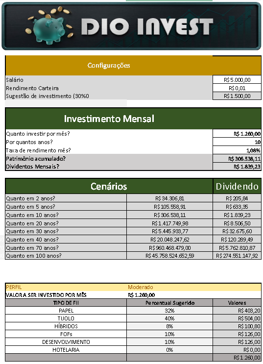

# DIO INVEST — Controle de Investimentos

## Sobre o projeto

O DIO INVEST é uma ferramenta de controle e simulação de investimentos desenvolvida no Microsoft Excel durante um projeto da DIO.

O objetivo é auxiliar na organização de aportes mensais, simular o crescimento do patrimônio e visualizar possíveis rendimentos ao longo do tempo, utilizando diferentes perfis de investidor.

O projeto foi desenvolvido acompanhando as aulas, aplicando os conceitos e recursos apresentados durante o curso.

## Funcionalidades e perguntas respondidas

A ferramenta permite responder às seguintes perguntas:

1. **Quanto investir por mês?**  
   Apresenta o valor mensal sugerido para investimento, considerando o salário e o percentual configurado.

2. **Por quantos anos investir?**  
   Permite definir o período de investimento em anos.

3. **Qual a taxa de rendimento mensal?**  
   Apresenta a taxa mensal utilizada nas simulações.

4. **Qual será o patrimônio acumulado?**  
   Calcula o valor futuro estimado dos investimentos, considerando os aportes mensais e a taxa de rendimento.

5. **Quais serão os dividendos mensais?**  
   Estima os dividendos mensais com base no patrimônio acumulado e no rendimento da carteira.

As respostas aparecem na aba **Planilha1**, na seção de investimento mensal e nas tabelas de cenários.

## Fórmulas utilizadas

### VF — Valor Futuro

A função `VF` é utilizada para calcular o patrimônio acumulado ao longo do período de investimento.

Exemplo da fórmula utilizada:

```excel
=VF(D18;D17*12;D16*-1)
```

- `D18`: taxa de rendimento mensal.
- `D17*12`: quantidade de meses de investimento.
- `D16*-1`: valor do aporte mensal, convertido para negativo para representar uma saída de dinheiro.

### PROCV — Pesquisa de dados

A função `PROCV` é utilizada para buscar os percentuais de distribuição de investimentos de acordo com o perfil selecionado e a categoria do Fundo Imobiliário.

Exemplo:

```excel
=PROCV($C$35&"-"&B38;Planilha2!$A:$D;4;FALSO)
```

A fórmula combina o perfil do investidor com a categoria do FII, procura essa combinação na tabela de referência da Planilha2 e retorna o percentual correspondente.

## Intervalos nomeados

Foram utilizados os seguintes intervalos nomeados para facilitar a identificação das células nas fórmulas:

| Nome | Referência |
|---|---|
| Aporte | Planilha1!D16 |
| Qtd_anos | Planilha1!D17 |
| Rendimento_carteira | Planilha1!D11 |
| Taxa_mensal | Planilha1!D18 |

## Distribuição dos perfis de investimento

Os percentuais abaixo foram utilizados como exemplos didáticos apresentados durante as aulas, para demonstrar diferentes estratégias de distribuição de investimentos.

| Categoria | Conservador | Moderado | Agressivo |
|---|---:|---:|---:|
| Papel | 30% | 32% | 50% |
| Tijolo | 50% | 40% | 10% |
| Híbridos | 10% | 8% | 5% |
| FOFs | 10% | 10% | 5% |
| Desenvolvimento | 0% | 10% | 20% |
| Hotelaria | 0% | 0% | 10% |
| **Total** | **100%** | **100%** | **100%** |

## Testes realizados

A ferramenta foi testada utilizando os três perfis disponíveis:

- Conservador;
- Moderado;
- Agressivo.

Ao alterar o perfil na lista suspensa, a distribuição percentual dos aportes é atualizada automaticamente por meio da função PROCV.

Os três perfis apresentam distribuição total de 100%.

## Desenvolvimento e adaptações

O projeto foi desenvolvido acompanhando as aulas da DIO, reproduzindo a construção da ferramenta e aplicando os conceitos apresentados.

Os percentuais dos perfis foram utilizados como exemplos didáticos do curso. Não foram tratados como recomendações financeiras.

## Tecnologias utilizadas

- Microsoft Excel
- Função VF
- Função PROCV
- Intervalos nomeados
- Fórmulas financeiras
- Validação de dados e listas suspensas

## Prévia do projeto



## Observação

Os valores e resultados apresentados são simulações baseadas nas configurações utilizadas na planilha. As projeções não representam garantia de rentabilidade nem recomendação de investimento.
